# Tropics Scorecard

How close was the forecast to what the instruments measured, and how sure are we?

This repository scores hourly rain, temperature and wind forecasts for Singapore against station observations rather than a reanalysis. Every comparison carries a 95 percent interval. The ERA5 reanalysis is scored the same way, and then used as a second judge, to show what changes when the truth is a model.

[](https://github.com/awvmeijer/tropics-scorecard/actions/workflows/tests.yml)

**[Read the one-page summary](https://awvmeijer.github.io/tropics-scorecard/)**: a scorecard across lead days, what the choice of score does to the rain verdict, a perfect-forecast ceiling, an extremes test, a decision score, the reanalysis as a second judge, a model fitted to the stations, three replayed events, and what the checks caught.

<p align="center">
  <picture>
    <source media="(prefers-color-scheme: dark)" srcset="docs/assets/pipeline-dark.svg">
    <source media="(prefers-color-scheme: light)" srcset="docs/assets/pipeline-light.svg">
    
  </picture>
</p>

## What it found

<p align="center">
  <picture>
    <source media="(prefers-color-scheme: dark)" srcset="docs/assets/result-dark.svg">
    <source media="(prefers-color-scheme: light)" srcset="docs/assets/result-light.svg">
    
  </picture>
</p>

- **Against the instruments, raw forecasts lose to a free guess.** By root mean square error, GFS and ECMWF's IFS are never detectably better than climatology for temperature, wind or rain at a station, at any lead time. The 7 cells of 76 that are belong to ECMWF's AIFS, the learned model.
- **The score and the judge decide the verdict.** By mean absolute error ECMWF's rain looks 13 percent better than climatology, but a forecast that never rains looks 41 percent better. Judged by the ERA5 reanalysis instead of the instruments, GFS and ECMWF swap places for temperature. One matching choice moves a score more than switching models does, and two of the first results were faults in the forecast archive.
- **The gap is not just a point against a grid cell.** A perfect forecast at ECMWF's grid size would cut 6-hour rain error at a gauge by 42 percent (27 to 68). ECMWF's cuts nothing, and its heaviest totals are a third of what the gauges measured. A squall line put 10 mm in an hour on half of Singapore's gauges, and no forecast had it at any lead time.
- **The information is there, and station data unlocks it.** A linear fit of the same raw forecasts to 17 months of station data beats climatology for temperature by 13 percent (9 to 18) on the following 16 months, and by 17 percent (12 to 22) at stations it never saw. For rain the gain is 2 percent.

If a weather model is meant to learn from observations, it should be judged on them too. This repository is a small, working version of that judge.

The full write-up is in [docs/findings.md](docs/findings.md), the case studies in [docs/cases/](docs/cases/), and what went wrong and why in [docs/failure_modes.md](docs/failure_modes.md).

## Limits, first

- A rain gauge measures one point. A forecast is an average over a grid cell 9 to 28 km wide, so it shows more light rain and less heavy rain than any gauge. Part of every low rain score comes from that mismatch.
- Stations have errors. Tipping-bucket gauges catch less rain than falls in strong wind and very heavy rain. No correction is applied.
- The test period is under three years (February 2024 to October 2026), so each monsoon phase appears two or three times.
- Two of the models publish rain in 3-hour or 6-hour steps, so hourly rain is not a fair test for them. Rain is also scored as 6-hour totals.
- This is one region and one set of public archives. It is not a benchmark of record.

## What is scored

| | |
|---|---|
| Observations | Singapore station network (data.gov.sg): 54 to 80 rain gauges a year at 5 minutes from 2017 to 2025, and 91 in 2026; 15 to 21 temperature and wind stations a year at 1 minute, and 35 temperature stations in 2026. Airport reports (NOAA ISD) for temperature and wind, which end on 24 August 2025. Changi soundings (IGRA) for case studies |
| Forecasts | GFS and ECMWF IFS 0.25° at lead days 1, 2, 3, 5 and 7 (Open-Meteo Previous Runs); whole runs from April 2026 for hour-by-hour lead times. ECMWF AIFS and IFS 9 km on their shorter archives, scored apart |
| Baselines | Persistence and climatology, exposed exactly like a model |
| Intervals | Moving-block bootstrap over days, on paired differences between two forecasts on the same cases |
| Summary tables | A scorecard of the change in root mean square error against climatology at every lead day, with mean absolute error and an always-dry forecast alongside for rain, and an extremes test comparing the heaviest 6-hour rain totals with the gauges, alone and averaged over each grid cell |
| Validation | The standard evaluation statistics with their benchmarks, anomaly correlation, how fast gauges stop agreeing with distance, and a perfect forecast at the model's grid size as a ceiling |
| Trained model | A linear fit of the raw forecasts to station data, trained on the first 17 months and scored on the next 16, at stations it saw and stations it never saw |
| Decision value | How much of a perfect forecast's saving a user keeps by protecting whenever the forecast says 10 mm of rain or more, for every ratio of the cost of protecting to the loss avoided |
| Reanalysis | ERA5, scored against the stations like a forecast, and used as a second judge of the same forecasts on the same station-hours |

The rules were written down before any scoring in [docs/verification_protocol.md](docs/verification_protocol.md). Its dated change log records every later change, including the analyses added after the main scoring. How each observation source fails, and which check catches it, is in [docs/observation_notes/](docs/observation_notes/).

## Run it

```
uv sync --extra dev
uv run pytest
```

Downloading comes first and takes hours, because the free endpoints are rate limited. Every response is cached under `data/raw/`, so a download can stop and resume:

```
uv run python -m tropics_scorecard.ingest.datagovsg rainfall,air-temperature,wind-speed 2017-01-01 2026-10-31 --v1
uv run python -m tropics_scorecard.ingest.isd 2017 2025
uv run python -m tropics_scorecard.ingest.igra
uv run python -m tropics_scorecard.ingest.openmeteo all
uv run python -m tropics_scorecard.ingest.era5 all
```

Then one command rebuilds every table from the downloads, runs the quality checks, scores every forecast and writes the dashboard data, and a second builds the summary page:

```
uv run python -m tropics_scorecard.pipeline all
uv run python scripts/build_story.py
```

The maps' coastline is Natural Earth's 1:10m land file, saved as `data/raw/basemap/ne_10m_land.geojson`; without it the maps keep the copy already in `dashboard/data/`. The dashboard is a static site in `dashboard/`. Serve it with any static server, for example `python -m http.server -d dashboard`.

## Layout

```
ingest/     one module per source; raw responses cached under data/raw/
store/      tidy Parquet tables, read through DuckDB
qc/         range, spike, flatline, duplicate, stuck-gauge and clock checks; every flag logged
match/      the hourly reference the forecasts are scored against
sources/    one interface for anything that forecasts: operational models and ERA5
baselines/  persistence, climatology and an always-dry forecast
scorer/     scores, comparisons, intervals, the summary and validation tables and the trained model; all maths in metrics/
metrics/    the metric functions, standard library only
cases/      replay one event from one command
dashboard/  static site reading precomputed JSON
```

## Data and attribution

- Singapore weather station data: Meteorological Service Singapore, via [data.gov.sg](https://data.gov.sg), Singapore Open Data Licence.
- Airport observations: NOAA National Centers for Environmental Information, Integrated Surface Database.
- Soundings: NOAA Integrated Global Radiosonde Archive, version 2.
- Forecasts: [Weather data by Open-Meteo.com](https://open-meteo.com/), CC BY 4.0. Values are taken from one grid cell per station, unchanged.
- Reanalysis: ERA5, Copernicus Climate Change Service, via [Open-Meteo.com](https://open-meteo.com/), CC BY 4.0. One grid cell per station, unchanged.
- Coastline: Natural Earth, public domain.
